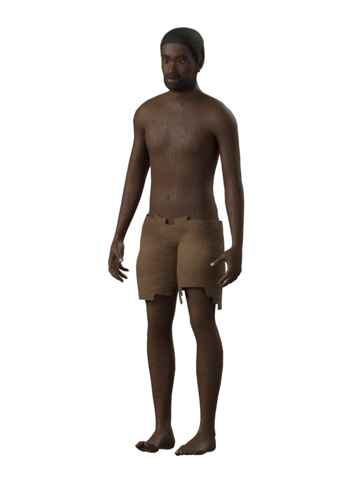

# Origin & Evolution of Man

An interactive, evidence-aware journey through human evolution — from Miocene apes to modern humans.

**[View the live experience](https://vishalbhoir18.github.io/humanevolution/)**



## What you can explore

- Seven 3D life reconstructions that can stand, walk, turn, and display anatomy hotspots
- A branching evolutionary tree of about 30 species, from Miocene apes through Ardipithecus, the australopiths and Paranthropus to Neanderthals, Denisovans and Homo sapiens, with expandable groups and key evolutionary leaps
- Life-size augmented reality for supported phones and tablets
- Fossil skull diagrams and specimen records
- Cranial-capacity comparisons
- A map of important fossil sites
- Evidence, uncertainty, and source notes for every reconstruction
- A collapsible APA 7 reference list of the research behind the site

## Included stages

| Stage | Main archaeological context |
| --- | --- |
| Dryopithecus | Miocene ape-like primate |
| Sivapithecus / Ramapithecus | Miocene ape from the Siwalik region |
| Australopithecus | Early upright hominins |
| Homo habilis | Early stone-tool-associated hominins |
| Homo erectus | First widely travelled human species |
| Neanderthals | European and western Asian hominins |
| Homo sapiens | Modern humans |

## Run locally

This is a static website and can be opened through any local web server:

```bash
python -m http.server 8000
```

Then visit <http://localhost:8000>.

A local server is recommended because the 3D models, AR assets, modules, and map resources are loaded from separate files.

## Rebuild the 3D assets

The reconstructions are generated with Blender and Python from a CC0 MakeHuman/MPFB2 base mesh. Fossil measurements define proportions and anatomy, while soft tissue, pigmentation, hair, and clothing remain explicitly identified as inferred.

See [the model-pipeline documentation](tools/README.md) for full rebuild and diagram-generation instructions.

## Scientific approach

This project distinguishes among:

- Measurements and features supported by preserved fossils
- Reconstructions based on related specimens or established comparative anatomy
- Informed interpretations clearly identified as assumptions
- Information that goes beyond a typical school syllabus

The models are stylised reconstructions, not fossil scans or photorealistic portraits. They are designed to communicate anatomy and uncertainty, not to replace fossil specimens or peer-reviewed scholarship.

## Licence

The interactive application and generated models are licensed under **CC BY-SA 4.0**. Individual third-party assets retain their stated licences.

See the [3D pipeline licence details](tools/README.md#licences) for base-mesh and software information.

## Author

Created by [Vishal Bhoir](https://linktr.ee/thebioway).
